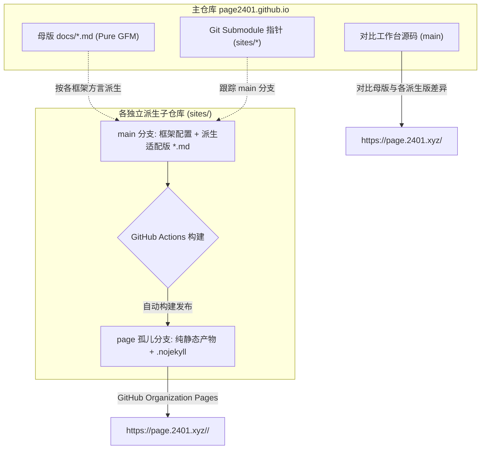
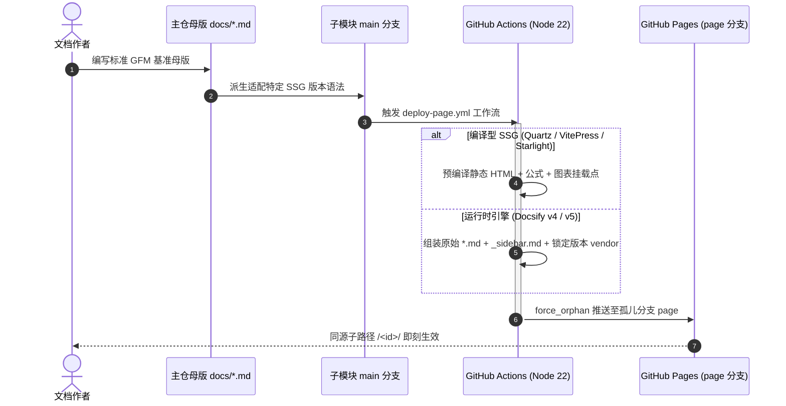
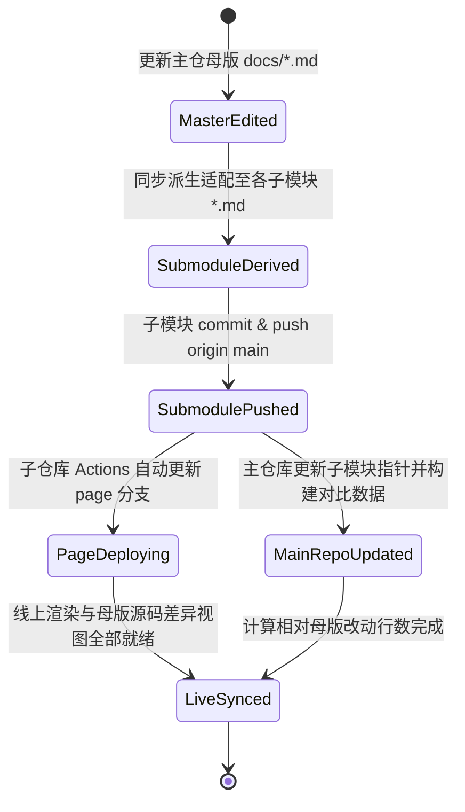

# 02. 流程图与时序图（Quartz v4 · Mermaid 12 基准）

Quartz v4 在 `Plugin.ObsidianFlavoredMarkdown()` 中开箱内置了 ```` ```mermaid ```` 识别、深浅色主题变量自动映射以及右上角全屏拖拽缩放模态框（`DiagramPanZoom`）。

> [!info]+ 零外部 CDN 与 `<id>` 尖括号吞噬修复实录
> 1. **离线本地化**：上游 Quartz v4 默认在浏览器运行时从 `cdnjs.cloudflare.com` 动态加载 `mermaid@11.4.0`；本基准站将其升级并改造为本地 `static/mermaid/mermaid.esm.min.mjs`（精确锁定 `mermaid@12.3.0`）。
> 2. **尖括号 `<id>` 解析陷阱**：上游 `mermaid.inline.ts` 读取 `node.innerText` 后误用 `node.innerHTML = oldText` 写回源码，导致母版节点标签中的 `<id>` 被浏览器当作未闭合 HTML 标签并在末尾自动补全 `</id></id>` 触发语法报错；改用 `node.textContent = oldText` 后完美原样渲染。可结合 [[01-annotations|专属标注]] 与 [[03-math|数学公式排版]] 对比构建策略。

## 1. 复杂子图与架构流程图（`flowchart TD`）

测试中文节点标签、子图嵌套（`subgraph`）、虚线边与条件分支：



## 2. 编译管线交互时序图（`sequenceDiagram`）

测试多参与者生命线、`alt` 分支块及激活框（`activate`/`deactivate`）：



## 3. 子模块同步状态机（`stateDiagram-v2`）

测试状态机语法与状态迁移说明标签：


